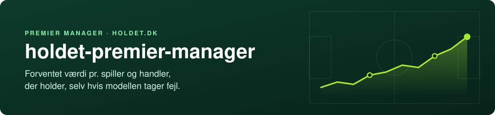
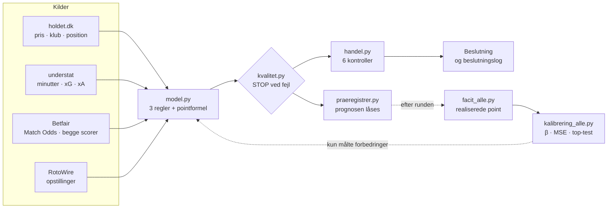

<p align="center">
  
</p>

<p align="center">
  <a href="https://github.com/anjo21ad/holdet-premier-manager/actions/workflows/test.yml"></a>
  
  
  <a href="LICENSE"></a>
</p>

En lille, gennemsigtig model til **Premier Manager** på [holdet.dk](https://www.holdet.dk). Den regner hver spillers forventede værdistigning resten af sæsonen ud fra xG, odds og opstillinger. Derefter anbefaler den kun en handel, hvis handlen også holder, når modellen tager fejl på de måder, vi ved den kan.

**Standard er ingen handel.**

---

## Spillet på et halvt minut

Du har 11 spillere og et budget. Point er det samme som prisændring. Et mål fra en midtbanespiller løfter hans pris med 150.000 kr., et clean sheet giver en forsvarer 50.000 kr., og et gult kort koster 20.000 kr. Kaptajnen tæller dobbelt, kontanter i banken giver 1 % rente pr. runde, og hvert køb koster 1 % i gebyr.

Målet er derfor at få holdets samlede værdi til at vokse mest muligt. En handel skal tjene både gebyret og den tabte rente hjem, ellers er den en dårlig handel, selv om den nye spiller er bedre.

## Hvorfor endnu en model?

Fordi det svære ikke er at finde spillere med høj forventning. Det svære er ikke at blive snydt af dem.

Når du leder blandt 600 spillere efter den højeste forventning, finder du systematisk dem, hvor støjen tilfældigvis trækker estimatet op. Det hedder **optimizerens forbandelse** (Smith & Winkler 2006). Projektets første udgave havde fem håndtunede lag. En dag blev otte handelsforslag efterprøvet, og alle otte faldt.

Svaret blev ikke flere lag, men færre:

- **Én fil, tre regler.** Et estimat, der hviler på lidt data, trækkes mod det typiske, indtil der er data nok til at tro på det.
- **Seks kontroller pr. handel.** Handlen skal holde, også hvis forskellen mellem spillerne er overvurderet, eller spilletiden svigter.
- **Præregistrering og kalibrering.** Alle prognoser låses før deadline og måles mod det, der skete.
- **Et kompleksitetsbudget.** Intet nyt lag uden en målt forbedring i backtest.

## Sådan virker det



### Modellen: tre regler og én pointformel

| | Regel | Hvad den gør |
|---|---|---|
| 1 | **Rate (Marcel)** | xG og xA pr. 90 minutter fra **starter** i tre sæsoner, vægtet 1,0 / 0,8 / 0,6. Minutter i en anden klub tæller halvt. Raten trækkes mod medianen for spillerens rolle med 1.000 minutters vægt |
| 2 | **Spilletid** | Næste runde fra RotoWire. Resten af sæsonen er ½ status + ½ startandel i klubbens seneste 15 kampe |
| 3 | **Holdstyrke** | Preseason-tier som udgangspunkt, opdateret med de Poisson-λ, der rammer Betfairs priser for sejr og "begge hold scorer" |
| | **Pointformel** | Spillets regler i `ev_kamp()`. `evaluer()` er det eneste sted, EV beregnes |

```
g90 = (Σ v · xG · 90 + K · prior_rolle) / (Σ v · minutter + K)        K = 1.000 minutter
```

En spiller med 500 vægtede minutter hviler altså 2/3 på prioren. Det er meningen.

### Beslutningsreglen: seks kontroller

Gevinsten regnes over resten af sæsonen, netto af gebyr og bankrente. En handel anbefales kun, hvis den er positiv i **alle seks**:

| Kontrol | Spørgsmålet |
|---|---|
| basis | Holder den med modellen, som den er? |
| forskel −25 % | ... hvis forskellen mellem spillerne er overvurderet, som kalibreringen viser (β ≈ 0,75-0,8)? |
| K/2 | ... hvis vi stoler mere på spillernes egne data? |
| 2K | ... hvis vi stoler mere på rolleprioren? |
| ind pS −0,1 | ... hvis de nye spiller mindre end ventet? |
| ud pS +0,1 | ... hvis de gamle spiller mere end ventet? |

En spiller, hvis rate hviler over 50 % på prioren, anbefales aldrig uden et menneskes vurdering, for modellen kender ham ikke.

### Et eksempel

Eksempelholdet i [`eksempler/hold.json`](eksempler/hold.json) før runde 8 i Efterår 2026. Jack Clarke er på vej ud af Ipswichs startopstilling:

```text
$ python handel.py "Jack Clarke > Pedro Neto"

Clarke > Neto
  basis +510   forskel -25 % +355   K/2 +520   2K +503   ind pS -0,1 +407   ud pS +0,1 +451
  -> ANBEFALES (positiv i 6 af 6; vaerst +355 tkr)

UD  Jack Clarke (IPS, midfield/AM): g90 0.18  a90 0.17  pS naeste 0.25  pStart 0.27  ev_tot 92
      bygger paa 631 vaegtede startminutter (prioren vejer 61 %): 2024 IPS 827 min (xg90 0.09); 2026 IPS 135 min (xg90 0.1)
      spilletid: RotoWire-status 0.25, startandel 0.29 over 7 klubkampe
      ! tynd: 135 startmin i aar
IND Pedro Neto (CHE, midfield/AM): g90 0.20  a90 0.23  pS naeste 0.72  pStart 0.76  ev_tot 712
      bygger paa 3708 vaegtede startminutter (prioren vejer 21 %): 2024 CHE 2000 min (xg90 0.17); 2025 CHE 2502 min (xg90 0.17); 2026 CHE 506 min (xg90 0.35)
      spilletid: RotoWire-status 0.72, startandel 0.8 over 15 klubkampe
```

Regnestykket bag basis: 712 − 92 = +620 tkr i forventet vækst over 13 runder. Gebyret på 1 % af Netos pris koster 48, og den ekstra kapital, der bindes, koster 62 i tabt rente. Netto **+510**. Bemærk også forklaringen: Clarkes tal hviler 61 % på prioren, Netos kun 21 %. Før et tal bruges til en handel, skal man se, hvad det er målt under.

Og her er en handel, der er positiv i alle seks kontroller og alligevel ikke anbefales:

```text
$ python handel.py "Jack Clarke > Jack Rudoni"

Clarke > Rudoni
  basis +569   forskel -25 % +454   K/2 +618   2K +532   ind pS -0,1 +486   ud pS +0,1 +510
  -> anbefales IKKE (positiv i 6 af 6; vaerst +454 tkr)

  !! Jack Rudoni: raten hviler over 50 % paa prioren - modellen kender ikke spilleren. Kraever manager-vurdering.
```

### Kvalitetsporte

Datakilderne fejler tavst. understat svarer 404-HTML på 461 bytes uden den rigtige header, holdet.dk svarer 200 med en HTML-skal på forkerte stier, og Betfair kan levere det forkerte marked uden at klage. Hver af de fælder er blevet til en port i `kvalitet.py`, som stopper med exit-kode 1, før der træffes en beslutning på forkerte data.

## Evidens

Facit regnes fra understat og rammer holdets egne point kroneeksakt for **90-97 %** af spillerne.

Backtest på 808 spiller-runder (R4-R5, Efterår 2026), sammenlignet med projektets første, lagdelte model:

| | MSE | β, under 5 kampes evidens | β, over 15 kampes evidens |
|---|---:|---:|---:|
| Første model, fem lag | 3.504 | 0,34 | 1,16 |
| Denne model | **3.258** | **0,96** | 0,95 |

β er hældningen, når realiserede point regresseres på prognosen. 1 betyder kalibreret, under 1 betyder, at prognoserne spreder sig mere end virkeligheden. For spillere med tynd evidens var den første models forskelle mest støj. Shrinkagen fjernede det. Det svage punkt er spillere med 5-15 kampes evidens, og det følges runde for runde. Detaljer i [docs/metode.md](docs/metode.md).

## Kom i gang

Kræver Python 3.10 eller nyere og intet andet.

```bash
git clone https://github.com/anjo21ad/holdet-premier-manager.git
cd holdet-premier-manager
cp eksempler/hold.json eksempler/manager_input.json .    # ret hold.json til dit eget hold

python hent.py holdet                       # priser, klubber og kampplan
python hent.py liga && python hent.py liga 2025
python hent.py rotowire 8                   # højst 24 timer før deadline
python hent.py betfair 8                    # kræver miljøvariablen BETFAIR_AK

python model.py 8                           # første gang hentes spillerhistorik (~5 min)
python facit_alle.py                        # realiserede point hidtil
python kvalitet.py --runde 8                # STOP = ingen beslutning på disse data
python handel.py --skan "Jack Clarke"       # de bedste afløsere, vurderet i alle seks kontroller
```

Testene kører uden data: `python test_model.py`.

Hele rytmen før deadline og efter hver runde står i [docs/arbejdsgang.md](docs/arbejdsgang.md).

## Indhold

| | |
|---|---|
| `hent.py` | Al hentning fra holdet.dk, understat, Betfair og RotoWire |
| `model.py` | De tre regler og pointformlen. Skriver `input/board.json` |
| `handel.py` | Seks kontroller pr. handel, `--skan` efter afløsere og `--log` til beslutningsloggen |
| `kvalitet.py` | Porte før en beslutning. Exit-kode 1 ved STOP |
| `praeregistrer.py` | Låser hele boardets prognose før deadline. Nægter at overskrive |
| `facit_alle.py` | Realiserede point for alle spillere ud fra understat |
| `kalibrering_alle.py` | β, MSE og top-test pr. præregistrering |
| `test_model.py` | Tests af regler, beslutningsregel, porte og pointmotor på syntetiske data |
| `docs/` | [Metode](docs/metode.md), [pointsystem](docs/pointsystem.md) og [arbejdsgang](docs/arbejdsgang.md) |
| `eksempler/` | Skabeloner til `hold.json` og `manager_input.json` |

## Begrænsninger

- Bygget til **Premier Manager Efterår 2026**. Til et nyt spil skal spil-id, sæsoner og preseason-tiers rettes ([se hvordan](docs/arbejdsgang.md#en-ny-sæson)).
- Straffe ligger i xG. En spiller, der har overtaget straffesparkene, er undervurderet.
- Spilletiden for nye klubspillere hviler meget på én RotoWire-status.
- Betfair prissætter kun én runde pålideligt frem. Resten af sæsonen regnes på holdstyrken.
- Genkøb af en skadet spiller efter en midlertidig afløser regnes ikke automatisk. Regn det runde for runde.

## Data og vilkår

Repoet indeholder **ingen data**. Scripts henter fra holdet.dk, understat, Betfair og RotoWire til din egen maskine, og `input/`, `exante/` og `facit/` er gitignoreret. Du er selv ansvarlig for at bruge kilderne efter deres vilkår, og de hentede filer må ikke deles videre.

Projektet er ikke tilknyttet holdet.dk, understat, Betfair eller RotoWire.

## Licens

[MIT](LICENSE).
