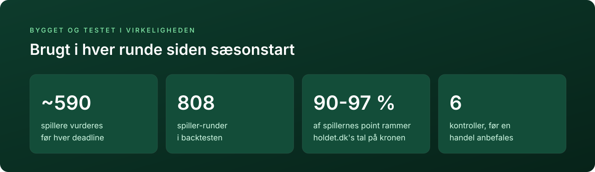

<p align="center">
  
</p>

<p align="center">
  <a href="https://github.com/anjo21ad/holdet-premier-manager/actions/workflows/test.yml"></a>
  
  
  <a href="LICENSE"></a>
</p>

<h3 align="center">Hvem skal du købe, og hvem skal du sælge?</h3>

Jeg har bygget en model til Premier Manager på [holdet.dk](https://www.holdet.dk) og brugt den på mit eget hold i hver runde siden sæsonstart. Den giver alle spillere ét tal: hvor meget de ventes at stige i værdi resten af sæsonen. Og den har en fast regel for, hvornår en handel betaler sig.

Prognoserne bliver gemt før deadline og holdt op mod resultatet bagefter. En ny regel kommer kun ind, hvis den rammer bedre.

## Inspireret af Marcel

<p align="center"></p>

Marcel er en prognosemodel fra baseball. Tom Tango lavede den for at vise, hvor langt man kommer med det mest basale: de seneste tre sæsoner vægtet 5/4/3 og et træk mod gennemsnittet, indtil der er data nok. Navnet kommer fra "Marcel the Monkey", fordi den skulle være så enkel, at en abe kunne regne den ud. Alligevel rammer den næsten lige så godt som langt større systemer som PECOTA, ZiPS og Steamer. I baseball er den blevet den målestok, nye prognoser bliver holdt op imod.

Jeg valgte den som udgangspunkt, fordi Premier Manager har præcis samme problem som baseball: få kampe, meget støj og en stærk fristelse til at tro på den seneste form. Marcel løser det med to regler, der kan forklares på en linje hver. Hvert tal kan følges tilbage til de minutter og sæsoner, det bygger på, og modellen har få steder at lade sig narre af tilfældigheder. Oversat til fodbold måler den xG og xA i stedet for mål, kun fra kampe, spilleren starter, og den trækker mod det typiske for spillerens rolle.

## Sådan virker det

<p align="center"></p>

| Kilde | Hvad den giver |
|---|---|
| **holdet.dk** | Priser, klubber og kampprogram |
| **understat** | Minutter, xG og xA fra hver kamp i tre sæsoner |
| **Betfair** | Match Odds: hvad markedet tror om hver kamp |
| **RotoWire** | Forventede startopstillinger til næste runde |

Før hver deadline tjekker modellen sine data. Er en fil for gammel, eller har en kilde svaret forkert, stopper den hellere end at regne videre.

<details>
<summary><b>For de nysgerrige: de tre regler og formlen</b></summary>
<br>

| | Regel | Hvad den gør |
|---|---|---|
| 1 | **Rate (Marcel)** | xG og xA pr. 90 minutter fra **starter** i tre sæsoner, vægtet 1,0 / 0,8 / 0,6. Minutter i en anden klub tæller halvt. Raten trækkes mod medianen for spillerens rolle med 1.000 minutters vægt |
| 2 | **Spilletid** | Næste runde fra RotoWire. Resten af sæsonen er ½ status + ½ startandel i klubbens seneste 15 kampe |
| 3 | **Holdstyrke** | Udgangspunkt før sæsonen, opdateret med de målforventninger, der passer til Betfairs priser |
| | **Pointformel** | Spillets regler i `ev_kamp()`. `evaluer()` er det eneste sted, forventningen beregnes |

```
g90 = (Σ v · xG · 90 + K · typisk_for_rollen) / (Σ v · minutter + K)        K = 1.000 minutter
```

De seks kontroller i `handel.py`: basis, forskellen −25 %, K/2, 2K, nye spillere −0,1 i spilletid og gamle spillere +0,1 i spilletid. En spiller, hvis tal er mere end 50 % gæt, anbefales aldrig uden et menneskes vurdering.

Hele begrundelsen med kilder står i [docs/metode.md](docs/metode.md).

</details>

## Mit hold: Skjoldes Juveler

<p align="center"></p>

Mit hold hedder **Skjoldes Juveler** og ligger nr. 79 af over 28.000 efter syv runder. Jeg bruger modellen, hver gang jeg overvejer en handel.

Før runde 8 skifter jeg Koumas ud med Schade. Koumas kom på bænken, da Isak var tilbage hos Liverpool, og Schade er klar igen efter en skulderskade. Modellen regner handlen til 526.000 kr. over resten af sæsonen, og den holder i alle seks spørgsmål. Kortet bliver opdateret efter hver runde.

<p align="center"></p>

> [!TIP]
> **Oftest er svaret at beholde holdet.** En handel koster gebyr og rente, så den skal kunne betale sig, også hvis tallene er lidt for optimistiske.

## Spillet på et halvt minut

<p align="center"></p>

Alt, hvad en spiller gør på banen, bliver til kroner på hans pris. Stiger dine spillere, stiger dit hold. Men hvert køb koster 1 % i gebyr, og penge, der står i spillere, giver ikke rente i banken. En handel skal altså tjene mere, end den koster.

## Den store fælde

<p align="center"></p>

Det er let at finde en spiller med flotte tal. Det svære er at vide, om tallene er ægte. Få kampe er for lidt til at skille talent fra held. Leder du blandt 600 spillere efter den, der ser bedst ud, finder du som regel den heldigste. Det kaldes *optimizerens forbandelse* (Smith & Winkler 2006).

Modellen er bygget til at undgå den fælde. Min første udgave havde fem lag håndlavede justeringer, og da jeg efterprøvede otte forslag til handler, holdt ingen af dem. Så byggede jeg den om fra bunden med få regler og en fast test af hver handel.

## Kuren: tro mest på det, der er set mange gange

<p align="center"></p>

Modellen lægger tre sæsoner sammen, hvor de nyeste kampe tæller mest, og trækker tallet mod det typiske for spillerens rolle. Jo flere kampe, jo mere vejer spillerens egne tal. Efter cirka elleve kampe vejer de mere end det typiske.

Saka og Palmer viser det i praksis. En god eller dårlig start flytter vurderingen, men overtager den ikke. Det er Marcel-princippet i praksis. Efron og Morris viste det samme med batting-gennemsnit i baseball i 1975.

## Hvad er en handel værd?

<p align="center"></p>

Handlen regnes over resten af sæsonen og ikke kun næste runde. Fra gevinsten trækkes gebyret og den rente, du mister, når pengene står i en spiller i stedet for i banken.

<details>
<summary><b>Sådan ser det ud i terminalen</b></summary>
<br>

Eksempelholdet i [`eksempler/hold.json`](eksempler/hold.json) før runde 8:

```text
$ python handel.py "Phil Foden > Bryan Mbeumo"

Foden > Mbeumo
  basis +458   forskel -25 % +297   K/2 +466   2K +443   ind pS -0,1 +324   ud pS +0,1 +340
  -> ANBEFALES (positiv i 6 af 6; vaerst +297 tkr)

UD  Phil Foden (MCI, midfield/CM): g90 0.25  a90 0.25  pS naeste 0.37  pStart 0.38  ev_tot 387
      bygger paa 2814 vaegtede startminutter (prioren vejer 26 %): 2024 MCI 1639 min (xg90 0.33); 2025 MCI 1945 min (xg90 0.26); 2026 MCI 275 min (xg90 0.54)
      spilletid: RotoWire-status 0.37, startandel 0.4 over 15 klubkampe
      ! tynd: 275 startmin i aar
IND Bryan Mbeumo (MUN, midfield/AM): g90 0.40  a90 0.20  pS naeste 0.78  pStart 0.82  ev_tot 1032
      bygger paa 3771 vaegtede startminutter (prioren vejer 21 %): 2024 BRE 3419 min (xg90 0.36); 2025 MUN 2644 min (xg90 0.45); 2026 MUN 630 min (xg90 0.58)
      spilletid: RotoWire-status 0.78, startandel 0.87 over 15 klubkampe
      ! klubskifte: minutter fra anden klub vaegtet x0.5
```

Under hver spiller står, hvad tallet bygger på: antal minutter, hvor meget det typiske for rollen vejer, og hvad man bør kigge efter. Foden har kun startet tre kampe i år og starter sjældent for tiden. Mbeumo bygger på tre hele sæsoner.

</details>

## Seks spørgsmål før hver handel

<p align="center"></p>

Målingerne viser tre steder, hvor prognoser som disse rammer ved siden af. Forskellen mellem spillerne er lidt mindre i virkeligheden, end prognoserne siger. Vægten på en spillers egne tal kan være for høj eller for lav. Og spilletid er svær at forudsige. Derfor bliver hver handel regnet igen, som om hver af de fejl var sket. Ét nej, og du beholder dit hold.

## Virker det?

<p align="center"></p>

Prognoserne bliver gemt før runden og kan ikke rettes bagefter. Efter runden ser jeg, hvor meget af forskellen mellem spillerne der holdt. Hos spillere med få kampe var den første models forskelle mest støj. Den nuværende model rammer næsten plet, og den samlede fejl er 7 % lavere (MSE 3.504 mod 3.258).

Pointene i målingen er regnet ud fra kampdata og rammer holdet.dk's egne tal på kronen for 90-97 % af spillerne. Spillere med 5-15 kampe bag sig er den gruppe, jeg holder mest øje med.

## Prøv det selv

Det eneste, du skal bruge, er Python 3.10 eller nyere.

```bash
git clone https://github.com/anjo21ad/holdet-premier-manager.git
cd holdet-premier-manager
cp eksempler/hold.json eksempler/manager_input.json .    # ret hold.json til dit eget hold

python hent.py holdet                       # priser, klubber og kampprogram
python hent.py liga && python hent.py liga 2025
python hent.py rotowire 8                   # højst 24 timer før deadline
python hent.py betfair 8                    # kræver miljøvariablen BETFAIR_AK

python model.py 8                           # første gang hentes spillerhistorik (~5 min)
python facit_alle.py                        # faktiske point hidtil
python kvalitet.py --runde 8                # STOP betyder: ingen beslutning på disse data
python handel.py --skan "Phil Foden"        # de bedste afløsere, vurderet i alle seks spørgsmål
```

Testene kører uden data: `python test_model.py`. Hvad du gør før deadline og efter hver runde, står i [docs/arbejdsgang.md](docs/arbejdsgang.md).

<details>
<summary><b>Hvad ligger hvor</b></summary>
<br>

| | |
|---|---|
| `hent.py` | Henter fra holdet.dk, understat, Betfair og RotoWire |
| `model.py` | De tre regler og pointformlen. Skriver `input/board.json` |
| `handel.py` | Seks spørgsmål pr. handel, `--skan` efter afløsere og `--log` til en beslutningslog |
| `kvalitet.py` | Tjekker data før en beslutning og stopper ved fejl |
| `praeregistrer.py` | Låser alle prognoser før deadline. Nægter at overskrive |
| `facit_alle.py` | Regner de faktiske point ud for alle spillere |
| `kalibrering_alle.py` | Måler prognoserne mod facit |
| `test_model.py` | Tests på opdigtede spillere og kampe |
| `docs/` | [Metode](docs/metode.md), [pointsystem](docs/pointsystem.md) og [arbejdsgang](docs/arbejdsgang.md) |
| `eksempler/` | Skabeloner til `hold.json` og `manager_input.json` |

</details>

## Kendte forenklinger

- Sat op til Premier Manager i efteråret 2026. Til et nyt spil skal du rette spil-id, sæsoner og holdenes udgangspunkt ([se hvordan](docs/arbejdsgang.md#en-ny-sæson)).
- Straffespark ligger i xG. En spiller, der lige har overtaget straffesparkene, er undervurderet.
- Nye spillere i en klub får deres spilletid fra få kampe.
- Betfair prissætter næste runde. De senere runder regnes på holdstyrken.

## Data og vilkår

Repoet indeholder **ingen data**. Scriptene henter fra holdet.dk, understat, Betfair og RotoWire til din egen computer, og data kommer aldrig med i repoet. Du er selv ansvarlig for at bruge kilderne efter deres vilkår.

Projektet er ikke tilknyttet holdet.dk, understat, Betfair eller RotoWire.

## Licens

Koden er under [MIT](LICENSE). Skriften i illustrationerne er [Inter](https://rsms.me/inter/) under [SIL Open Font License](docs/img/LICENSE-Inter.txt).
