<p align="center">
  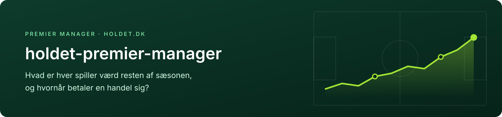
</p>

<p align="center">
  <a href="https://github.com/anjo21ad/holdet-premier-manager/actions/workflows/test.yml"></a>
  
  
  <a href="LICENSE"></a>
</p>

<h3 align="center">Hvem skal du købe, og hvem skal du sælge?</h3>

Denne model er lavet til Premier Manager på [holdet.dk](https://www.holdet.dk) og er brugt på mit eget hold i hver runde siden sæsonstart. Den giver alle spillere ét tal: hvor meget de ventes at stige i værdi resten af sæsonen. Og den har en fast regel for, hvornår en handel betaler sig.

**Mit hold, Skjoldes Juveler, ligger nr. 79 af over 28.000 efter syv runder.** Syv runder er for lidt til at skille dygtighed fra held, så det er et godt tegn og ikke et bevis. Hvorfor står under [Den store fælde](#den-store-fælde-held-ligner-talent).

## Hvorfor har jeg lavet det her?

Jeg synes, det er grineren at bruge data til at finde muligheder, som andre overser. Derudover kan jeg bare godt lide at vinde. Filmen Moneyball har ligeledes været en stor inspirationskilde til projektet.

I Moneyball har Oakland Athletics et af ligaens mindste budgetter. I stedet for at betale for det, alle kan se, som slaggennemsnit og homeruns, køber de spillere, der kommer på base. Det vinder kampe, og markedet prissatte det for lavt.

Premier Manager har samme skævhed. Det synlige er point og seneste form, og det er fristende at købe den spiller, der lige har scoret. Modellen ser på det, der skaber pointene: chancernes kvalitet, spilletid og holdets styrke.

## Spillet og målet

<p align="center">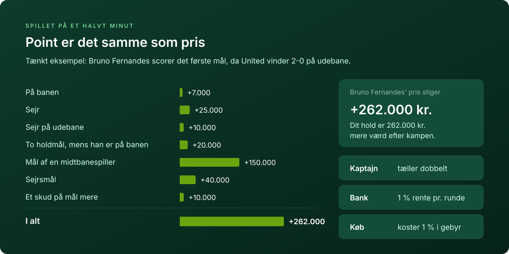</p>

I Premier Manager er point det samme som prisændring. Alt, hvad en spiller gør på banen, bliver til kroner på hans pris, og stiger dine spillere, stiger dit hold. Hvert køb koster 1 % i gebyr, og penge, der står i spillere, giver ikke den rente på 1 % pr. runde, som de ville give i banken.

Modellens mål er derfor holdets samlede værdi, netto af gebyr og rente. Det handler ikke om at eje de spillere, der giver mest pr. million, men om det hold, der giver mest i alt.

## Data: fire kilder

<p align="center">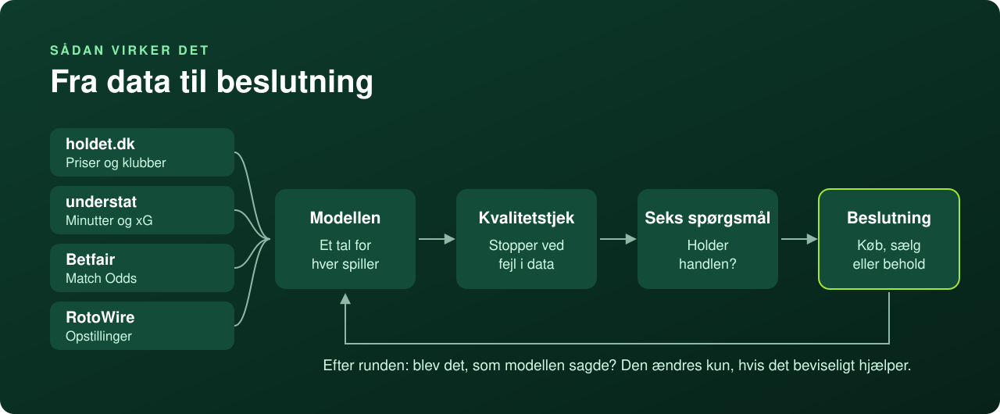</p>

| Kilde | Hvad den giver | Hvorfor den er vigtig |
|---|---|---|
| **holdet.dk** | Priser, klubber, positioner og kampprogram | Point er pris, så spillets egne tal er facit. holdet.dk er eneste autoritet, også når spillets univers afviger fra virkeligheden |
| **understat** | Minutter, xG og xA fra hver kamp i tre sæsoner | xG måler chancernes kvalitet og svinger mindre end mål. Det er grundlaget for spillerens egen rate |
| **Betfair** | Odds på næste runde: resultat, og om begge hold scorer | Markedet er det bedste offentlige bud på hver kamp. Herfra kommer sejrschance, mål for og imod og clean sheet. For Calafiori står det for 61 % af værdien |
| **RotoWire** | Forventede startopstillinger til næste runde | Alt ganges med spilletid. En spiller på bænken giver −5 |

Før hver deadline tjekker `kvalitet.py` data. Er en fil for gammel, eller har en kilde svaret forkert, stopper den hellere end at regne videre.

## Den store fælde: held ligner talent

<p align="center">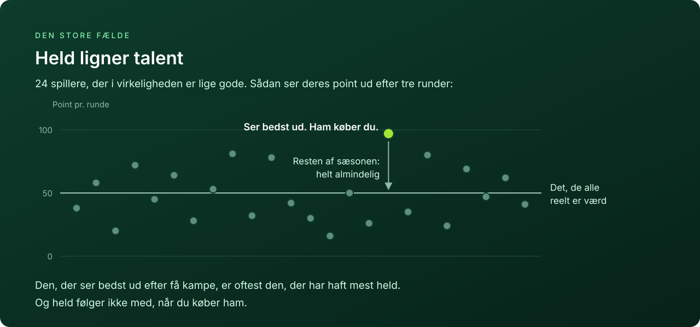</p>

Det er let at finde en spiller med flotte tal. Det svære er at vide, om tallene er ægte. Få kampe er for lidt til at skille talent fra held. Leder du blandt 600 spillere efter den, der ser bedst ud, finder du som regel den heldigste.

Modellen er bygget til at undgå den fælde. Den første udgave havde fem lag håndlavede justeringer, og da otte forslag til handler blev efterprøvet, holdt ingen af dem. Derfor blev modellen bygget om fra bunden med få regler og en fast test af hver handel.

## Principperne: tre regler

<p align="center">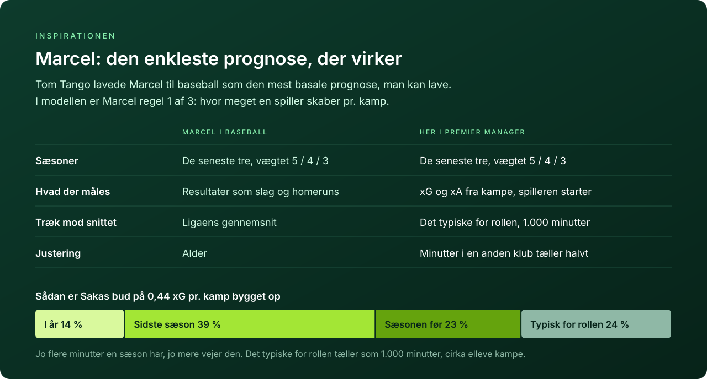</p>

**Spillerens rate følger Marcel.** Marcel er en prognosemodel fra baseball. Tom Tango lavede den for at vise, hvor langt man kommer med det mest basale: de seneste tre sæsoner vægtet 5/4/3 og et træk mod gennemsnittet, indtil der er data nok. Navnet kommer fra "Marcel the Monkey", fordi den skulle være så enkel, at en abe kunne regne den ud.

Premier Manager har samme problem som baseball: få kampe, meget støj og en stærk fristelse til at tro på den seneste form. Oversat til fodbold måler modellen xG og xA i stedet for mål, kun fra kampe, spilleren starter, og trækker mod det typiske for spillerens rolle. Hvert tal kan følges tilbage til de minutter og sæsoner, det bygger på.

<p align="center">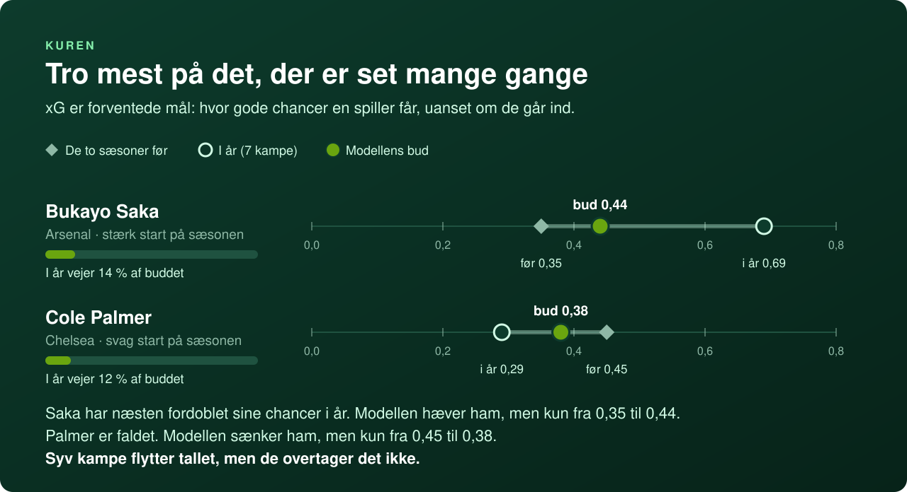</p>

Jo flere kampe, jo mere vejer spillerens egne tal. Efter cirka elleve kampe vejer de mere end det typiske for rollen. Saka og Palmer viser, hvordan det virker: en god eller dårlig start flytter vurderingen, men overtager den ikke.

**Spilletid kommer fra opstillingerne.** Næste runde regnes på RotoWires forventede opstilling. Resten af sæsonen er halvt RotoWire og halvt den andel af klubbens seneste 15 kampe, spilleren har startet.

**Holdstyrken kommer fra markedet.** Hvert hold har et udgangspunkt fra før sæsonen, som hver runde opdateres med de målforventninger, der passer til Betfairs odds. Næste kamp regnes direkte på oddsene.

<details>
<summary><b>For de nysgerrige: reglerne og formlen</b></summary>
<br>

| | Regel | Hvad den gør |
|---|---|---|
| 1 | **Rate (Marcel)** | xG og xA pr. 90 minutter fra **starter** i tre sæsoner, vægtet 1,0 / 0,8 / 0,6. Minutter i en anden klub tæller halvt. Raten trækkes mod medianen for spillerens rolle med 1.000 minutters vægt |
| 2 | **Spilletid** | Næste runde fra RotoWire. Resten af sæsonen er ½ status + ½ startandel i klubbens seneste 15 kampe |
| 3 | **Holdstyrke** | Udgangspunkt før sæsonen, opdateret med de målforventninger, der passer til Betfairs priser |
| | **Pointformel** | Spillets regler i `ev_kamp()`. `evaluer()` er det eneste sted, forventningen beregnes |

```
g90 = (Σ v · xG · 90 + K · typisk_for_rollen) / (Σ v · minutter + K)        K = 1.000 minutter
```

Hele begrundelsen med kilder står i [docs/metode.md](docs/metode.md).

</details>

## Et regnestykke: Calafiori mod Everton

<p align="center"></p>

Sådan bliver tallene til kroner for én spiller. Calafiori ventes at stige 76.100 kr., når Arsenal tager imod Everton i runde 8. Det er modellens låste prognose fra før deadline. Hvert led er en chance gange det, spillets regler giver, gange hvor meget han ventes at spille.

61 % af det kommer fra Arsenal og ikke fra Calafiori selv. Køber du en forsvarer, køber du hans hold. For Haaland er det omvendt: 78 % af hans forventede vækst kommer fra hans egne mål og chancer.

## Det samme for alle 589 spillere

<p align="center">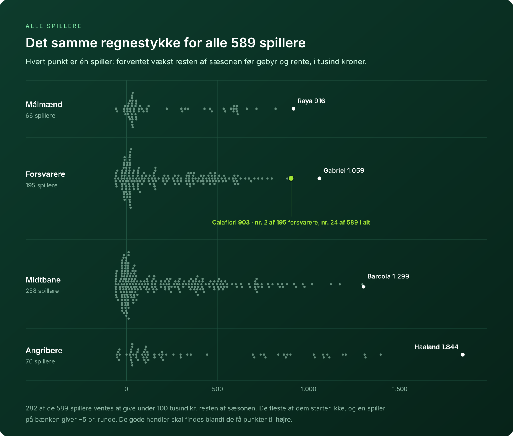</p>

Regnestykket gentages for hver kamp resten af sæsonen og for hver af de 589 spillere i spillet. For Calafiori giver det 903.000 kr. og en plads som nr. 2 blandt forsvarerne.

Næsten halvdelen af spillerne ventes at give under 100.000 kr., fordi de sjældent starter. De gode handler skal findes blandt de få spillere længst til højre.

## Før en handel anbefales

<p align="center">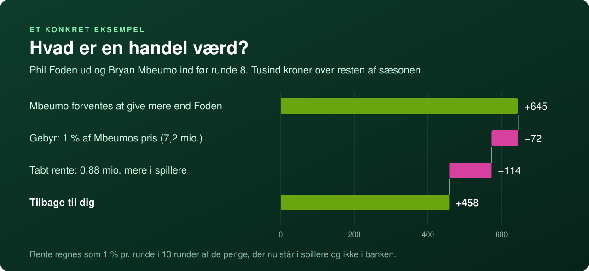</p>

En handel regnes over resten af sæsonen og ikke kun næste runde. Fra gevinsten trækkes gebyret og den rente, du mister, når pengene står i en spiller i stedet for i banken.

<details>
<summary><b>Sådan ser det ud i terminalen</b></summary>
<br>

Eksempelholdet i [`eksempler/hold.json`](eksempler/hold.json) før runde 8:

```text
$ python handel.py "Phil Foden > Bryan Mbeumo"

Foden > Mbeumo
  basis +458   forskel -25 % +297   K/2 +466   2K +443   ind pS -0,1 +324   ud pS +0,1 +340
  -> ANBEFALES (positiv i 6 af 6; vaerst +297 tkr)

UD  Phil Foden (MCI, midfield/CM): g90 0.25  a90 0.25  pS naeste 0.37  pStart 0.38  ev_tot 387
      bygger paa 2814 vaegtede startminutter (prioren vejer 26 %): 2024 MCI 1639 min (xg90 0.33); 2025 MCI 1945 min (xg90 0.26); 2026 MCI 275 min (xg90 0.54)
      spilletid: RotoWire-status 0.37, startandel 0.4 over 15 klubkampe
      ! tynd: 275 startmin i aar
IND Bryan Mbeumo (MUN, midfield/AM): g90 0.40  a90 0.20  pS naeste 0.78  pStart 0.82  ev_tot 1032
      bygger paa 3771 vaegtede startminutter (prioren vejer 21 %): 2024 BRE 3419 min (xg90 0.36); 2025 MUN 2644 min (xg90 0.45); 2026 MUN 630 min (xg90 0.58)
      spilletid: RotoWire-status 0.78, startandel 0.87 over 15 klubkampe
      ! klubskifte: minutter fra anden klub vaegtet x0.5
```

Under hver spiller står, hvad tallet bygger på: antal minutter, hvor meget det typiske for rollen vejer, og hvad man bør kigge efter. Foden har kun startet tre kampe i år og starter sjældent for tiden. Mbeumo bygger på tre hele sæsoner.

</details>

<p align="center">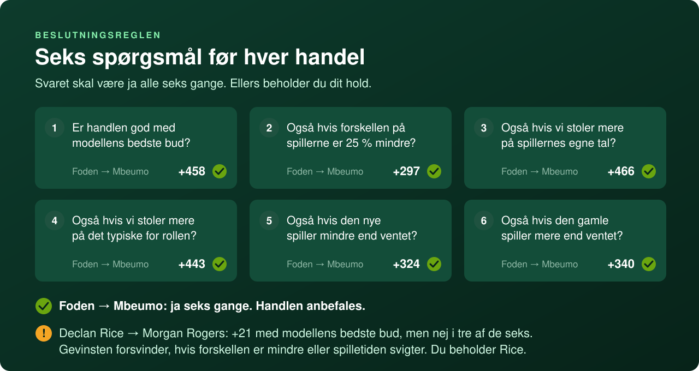</p>

En handel, der kun er god, hvis modellen har helt ret, er ikke god nok. Målingerne viser tre steder, hvor prognoser som disse rammer ved siden af, og hver kontrol regner handlen igen, som om en af fejlene var sket:

| Kendt fejl | Kontrol |
|---|---|
| Forskellene mellem spillerne er mindre i virkeligheden, end prognosen siger | Forskellen −25 % |
| Vægten på spillerens egne tal kan være for høj eller for lav | K/2 og 2K |
| Spilletid er svær at forudsige | Den nye spiller −0,1 og den gamle +0,1 i spilletid |

Sammen med basis, altså modellens bedste bud, giver det seks kontroller. Ét nej er nok til at beholde holdet. Hviler en ny spillers tal over 50 % på det typiske for rollen, anbefales han aldrig uden et menneskes vurdering.

> [!TIP]
> **Oftest er svaret at beholde holdet.** En handel koster gebyr og rente, så den skal kunne betale sig, også hvis tallene er lidt for optimistiske.

### Rundens handel

<p align="center">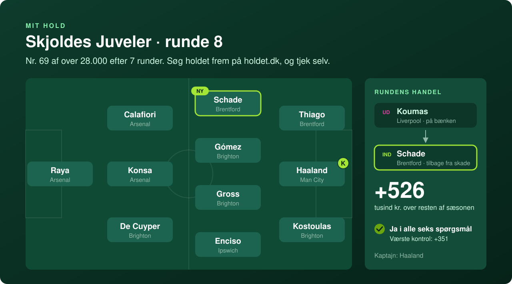</p>

Før runde 8 skifter jeg Koumas ud med Schade. Koumas kom på bænken, da Isak var tilbage hos Liverpool, og Schade er klar igen efter en skulderskade. Modellen regnede handlen til 526.000 kr. over resten af sæsonen, og den holdt i alle seks kontroller. Kortet bliver opdateret efter hver runde.

## Virker det?

<p align="center">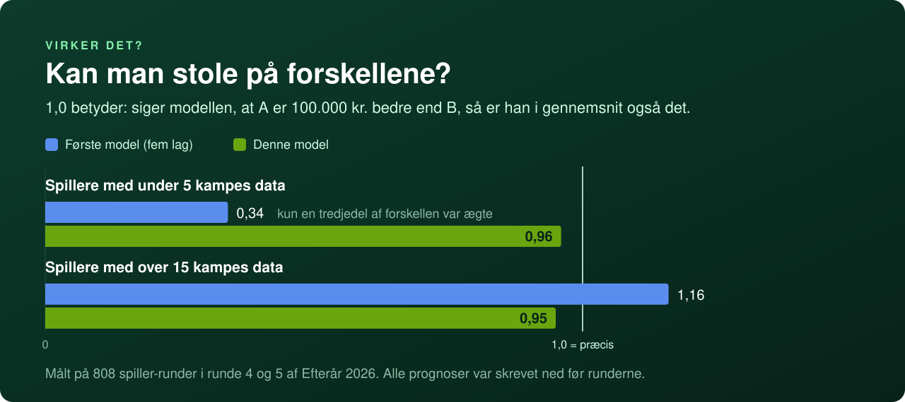</p>

Prognoserne låses med `praeregistrer.py` før hver deadline og kan ikke rettes bagefter. Efter runden måler jeg, hvor meget af forskellen mellem spillerne der holdt. 1,0 er præcist, og under 1 betyder, at prognosen overdriver forskellene.

- **Samlet holder det.** I de to runder, der er låst indtil nu, R6 og R7, er hældningen 0,90. Det ligger inden for de 25 %, som kontrollen "forskellen −25 %" dækker.
- **Toppen leverer det meste.** De 5 % højest rangerede spillere leverede 86 % af det lovede. Det er optimizerens forbandelse i lille skala, og det er grunden til, at kontrollerne findes.
- **Spillere med 5-15 kampe er det svage punkt.** Hældningen er 0,62, og det var også den svageste gruppe i backtesten. Gruppen følges runde for runde, og der ændres først noget, når der er tre runders evidens.
- **Én runde er for lidt.** Spillere med under 5 kampe lå på 1,28 i R6 og 0,36 i R7. Samlet er det 0,85, men stregerne viser, hvor usikkert det stadig er.

I backtesten på R4-R5 var den samlede fejl 7 % lavere end i den første model (MSE 3.200 mod 3.436). Hele faldet kom fra Betfair og RotoWire for runden. Marcel gjorde ikke fejlen mindre, men rettede, at prognoserne for spillere med få kampe var mest støj. Modellen er rettet én gang mellem R6 og R7.

Pointene i målingen er regnet ud fra kampdata og rammer holdet.dk's egne tal på kronen for 90-97 % af spillerne. Tallene opdateres, efterhånden som flere runder bliver låst og spillet.

## Kom i gang

Du skal bruge Python 3.10 eller nyere. Jeg anbefaler at bruge repoet sammen med [Claude Code](https://claude.com/claude-code). [CLAUDE.md](CLAUDE.md) indeholder arbejdsreglerne: `kvalitet.py` skal stå uden STOP, en handel skal holde i alle seks kontroller, og modellen fryses før deadline. Claude Code læser filen automatisk og følger reglerne. Du kan spørge på almindeligt dansk, for eksempel *"Hent data til runde 9 og find en afløser for Foden"*, og få svaret regnet på samme måde hver gang.

**Kør det så tæt på deadline som muligt.** Skader, pressemøder og forventede opstillinger ændrer sig hele ugen, og jo tættere du kommer på kampene, jo mindre ændrer data sig. RotoWire skal hentes højst 24 timer før deadline. Selve metoden ændres aldrig det sidste døgn: modellen fryses 24 timer før deadline, og derefter kommer kun nye data ind.

```bash
git clone https://github.com/anjo21ad/holdet-premier-manager.git
cd holdet-premier-manager
cp eksempler/hold.json eksempler/manager_input.json .    # ret hold.json til dit eget hold

python hent.py holdet                       # priser, klubber og kampprogram
python hent.py liga && python hent.py liga 2025
python hent.py rotowire 8                   # højst 24 timer før deadline
python hent.py betfair 8                    # kræver miljøvariablen BETFAIR_AK

python model.py 8                           # første gang hentes spillerhistorik (~5 min)
python facit_alle.py                        # faktiske point hidtil
python kvalitet.py --runde 8                # STOP betyder: ingen beslutning på disse data
python handel.py --skan "Phil Foden"        # de bedste afløsere, vurderet i alle seks kontroller
```

Testene kører uden data: `python test_model.py`. Hvad du gør før deadline og efter hver runde, står i [docs/arbejdsgang.md](docs/arbejdsgang.md).

<details>
<summary><b>Hvad ligger hvor</b></summary>
<br>

| | |
|---|---|
| `hent.py` | Henter fra holdet.dk, understat, Betfair og RotoWire |
| `model.py` | De tre regler og pointformlen. Skriver `input/board.json` |
| `handel.py` | Seks kontroller pr. handel, `--skan` efter afløsere og `--log` til en beslutningslog |
| `kvalitet.py` | Tjekker data før en beslutning og stopper ved fejl |
| `praeregistrer.py` | Låser alle prognoser før deadline. Nægter at overskrive |
| `facit_alle.py` | Regner de faktiske point ud for alle spillere |
| `kalibrering_alle.py` | Måler prognoserne mod facit |
| `test_model.py` | Tests på opdigtede spillere og kampe |
| `CLAUDE.md` | Arbejdsreglerne, som Claude Code følger |
| `docs/` | [Metode](docs/metode.md), [pointsystem](docs/pointsystem.md) og [arbejdsgang](docs/arbejdsgang.md) |
| `eksempler/` | Skabeloner til `hold.json` og `manager_input.json` |

</details>

## Kendte forenklinger

- Sat op til Premier Manager i efteråret 2026. Til et nyt spil skal du rette spil-id, sæsoner og holdenes udgangspunkt ([se hvordan](docs/arbejdsgang.md#en-ny-sæson)).
- Straffespark ligger i xG. En spiller, der lige har overtaget straffesparkene, er undervurderet.
- Nye spillere i en klub får deres spilletid fra få kampe.
- Betfair prissætter næste runde. De senere runder regnes på holdstyrken.
- Kaptajnens dobbelte vækst regnes med i `handel.py`, men ikke i spillernes tal i `board.json`.

## Data og vilkår

Repoet indeholder **ingen data**. Scriptene henter fra holdet.dk, understat, Betfair og RotoWire til din egen computer, og data kommer aldrig med i repoet. Du er selv ansvarlig for at bruge kilderne efter deres vilkår.

Projektet er ikke tilknyttet holdet.dk, understat, Betfair eller RotoWire.

## Licens

Koden er under [MIT](LICENSE). Skriften i illustrationerne er [Inter](https://rsms.me/inter/) under [SIL Open Font License](docs/img/LICENSE-Inter.txt).
