<p align="center">
  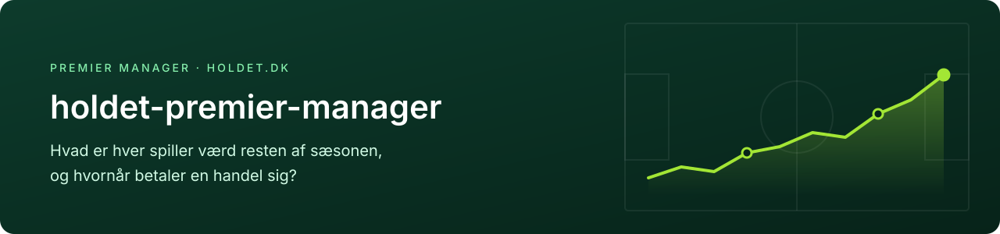
</p>

<p align="center">
  <a href="https://github.com/anjo21ad/holdet-premier-manager/actions/workflows/test.yml"></a>
  
  
  <a href="LICENSE"></a>
</p>

<h3 align="center">Hvem skal du købe, og hvem skal du sælge?</h3>

Denne model er lavet til Premier Manager på [holdet.dk](https://www.holdet.dk) og er brugt på mit eget hold i hver runde siden sæsonstart. Den giver alle spillere ét tal: hvor meget de ventes at stige i værdi resten af sæsonen. Og den har en fast regel for, hvornår en handel betaler sig.

**Mit hold, Skjoldes Juveler, ligger nr. 19 af over 28.000 efter ti runder.** Ti runder er for lidt til at skille dygtighed fra held, så det er et godt tegn og ikke et bevis. Hvorfor står under [Den store fælde](#den-store-fælde-held-ligner-talent).

## Hvorfor har jeg lavet det her?

Jeg synes, det er grineren at bruge data til at finde muligheder, som andre overser. Derudover kan jeg bare godt lide at vinde. Filmen Moneyball har ligeledes været en stor inspirationskilde til projektet.

I Moneyball har Oakland Athletics et af ligaens mindste budgetter. I stedet for at betale for det, alle kan se, som slaggennemsnit og homeruns, køber de spillere, der kommer på base. Det vinder kampe, og markedet prissatte det for lavt.

Premier Manager har samme skævhed. Det synlige er point og seneste form, og det er fristende at købe den spiller, der lige har scoret. Modellen ser på det, der skaber pointene: chancernes kvalitet, spilletid og holdets styrke.

## Spillet og målet

<p align="center">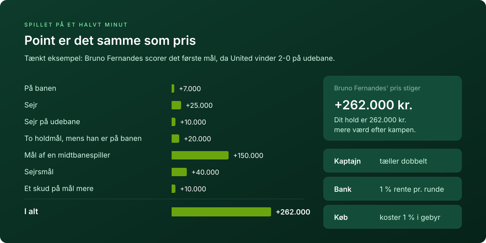</p>

I Premier Manager er point det samme som prisændring. Alt, hvad en spiller gør på banen, bliver til kroner på hans pris, og stiger dine spillere, stiger dit hold. Hvert køb koster 1 % i gebyr, og penge, der står i spillere, giver ikke den rente på 1 % pr. runde, som de ville give i banken.

Modellens mål er derfor holdets samlede værdi, netto af gebyr og rente. Det handler ikke om at eje de spillere, der giver mest pr. million, men om det hold, der giver mest i alt.

## Data: fire kilder

<p align="center">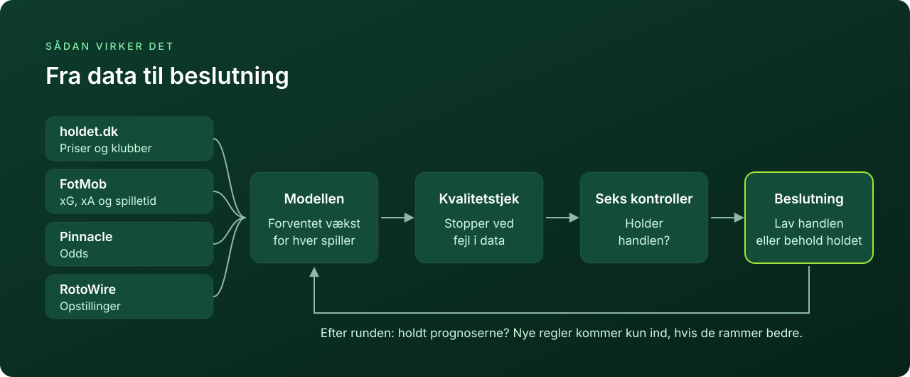</p>

| Kilde | Hvad den giver | Hvorfor den er vigtig |
|---|---|---|
| **holdet.dk** | Priser, klubber, positioner og kampprogram | Point er pris, så spillets egne tal er facit. holdet.dk er eneste autoritet, også når spillets univers afviger fra virkeligheden |
| **FotMob** | Starter, minutter, xG og xA fra hver kamp i tre sæsoner, i Premier League og de fire andre store ligaer | xG måler chancernes kvalitet og svinger mindre end mål. Det er grundlaget for spillerens egen rate |
| **Pinnacle** | Odds på næste runde: resultat og over/under 2,5 mål | Markedet er det bedste offentlige bud på hver kamp. Herfra kommer sejrschance, mål for og imod og clean sheet. For Gabriel står det for 66 % af værdien i runde 11 |
| **RotoWire** | Forventede startopstillinger til næste runde | Alt ganges med spilletid. En spiller på bænken giver −5 |

Før hver deadline tjekker `kvalitet.py` data. Er en fil for gammel, eller har en kilde svaret forkert, stopper den hellere end at regne videre.

Odds for runder, der allerede er spillet, kommer fra football-data.co.uk's arkiv.

## Den store fælde: held ligner talent

<p align="center">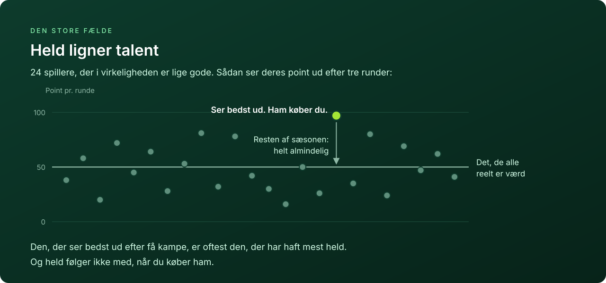</p>

Det er let at finde en spiller med flotte tal. Det svære er at vide, om tallene er ægte. Få kampe er for lidt til at skille talent fra held. Leder du blandt 600 spillere efter den, der ser bedst ud, finder du som regel den heldigste.

## Principperne: tre regler

Hver spillers tal bygger på tre regler: hvor meget han skaber, når han er på banen, hvor meget han spiller, og hvor stærkt hans hold er.

### 1. Hvad spilleren skaber: Marcel

<p align="center">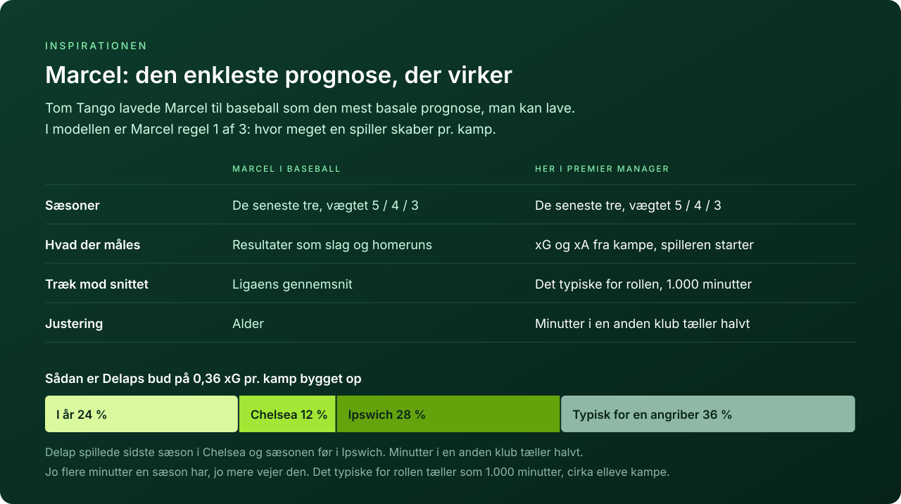</p>

Marcel er en prognosemodel fra baseball. Tom Tango lavede den for at vise, hvor langt man kommer med det mest basale: de seneste tre sæsoner vægtet 5/4/3 og et træk mod gennemsnittet, indtil der er data nok. Navnet kommer fra "Marcel the Monkey", fordi den skulle være så enkel, at en abe kunne regne den ud. Tabellen viser Marcels fire byggesten, og hvordan de er oversat til fodbold.

Premier Manager har samme problem som baseball: få kampe, meget støj og en stærk fristelse til at tro på den seneste form. Oversat til fodbold måler modellen xG og xA i stedet for mål, kun fra kampe, spilleren starter, og trækker mod det typiske for spillerens rolle. Straffespark regnes for sig: raten bygger på xG uden straffe, og bagefter lægges ligaens straffe-xG pr. kamp gange spillerens andel af klubbens straffe til. Hvert tal kan følges tilbage til de minutter og sæsoner, det bygger på.

<p align="center">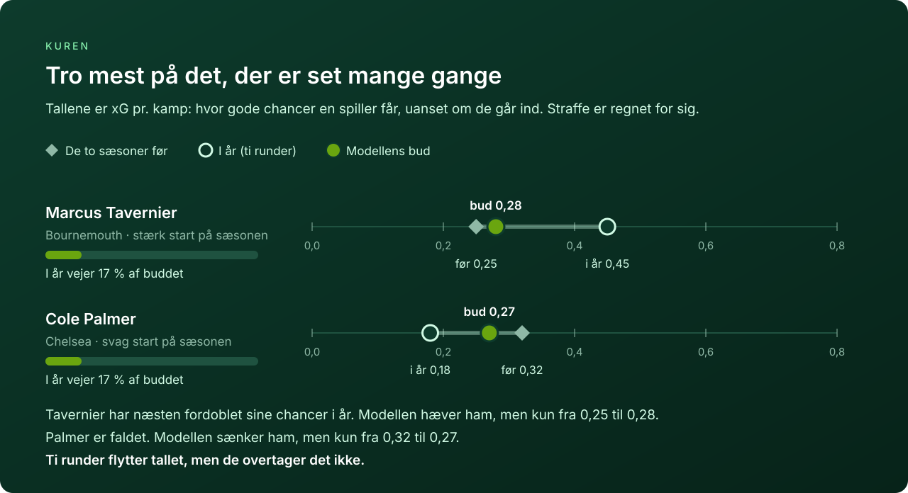</p>

Jo flere kampe, jo mere vejer spillerens egne tal. Efter cirka elleve kampe vejer de mere end det typiske for rollen. Tavernier og Palmer viser, hvordan det virker: en god eller dårlig start flytter vurderingen, men overtager den ikke.

### 2. Spilletid: opstillingerne

Næste runde regnes på RotoWires forventede opstilling. Resten af sæsonen er halvt RotoWire og halvt den andel af klubbens seneste 15 kampe, spilleren har startet. Andelen trækkes mod RotoWire med tre kampes vægt, så en spiller med få kampe for klubben ikke svinger fra den ene yderlighed til den anden.

### 3. Holdstyrke: markedet

Hvert hold har et udgangspunkt fra før sæsonen, som hver runde opdateres med de målforventninger, der passer til oddsene på resultat og antal mål. Næste kamp regnes direkte på oddsene.

<details>
<summary><b>For de nysgerrige: reglerne og formlen</b></summary>
<br>

| | Regel | Hvad den gør |
|---|---|---|
| 1 | **Rate (Marcel)** | xG uden straffe og xA pr. 90 minutter fra **starter** i tre sæsoner, vægtet 1,0 / 0,8 / 0,6. Minutter i en anden klub tæller halvt. Raten trækkes mod medianen for spillerens rolle med 1.000 minutters vægt. Straffe lægges til som et separat led: ligaens straffe-xG pr. holdkamp × spillerens andel af klubbens straffe |
| 2 | **Spilletid** | Næste runde fra RotoWire. Resten af sæsonen er ½ status + ½ startandel i klubbens seneste 15 kampe, trukket mod status med tre kampe |
| 3 | **Holdstyrke** | Udgangspunkt før sæsonen, opdateret med de målforventninger, der passer til oddsene: totalen fra P(over 2,5 mål) og fordelingen fra P(hjemmesejr) |
| | **Pointformel** | Spillets regler i `ev_kamp()`. `evaluer()` er det eneste sted, forventningen beregnes |

```
g90 = (Σ v · npxG · 90 + K · typisk_for_rollen) / (Σ v · minutter + K) + straffeled        K = 1.000 minutter
```

Hele begrundelsen med kilder står i [docs/metode.md](docs/metode.md).

</details>

## Et regnestykke: Delap mod Bournemouth

<p align="center">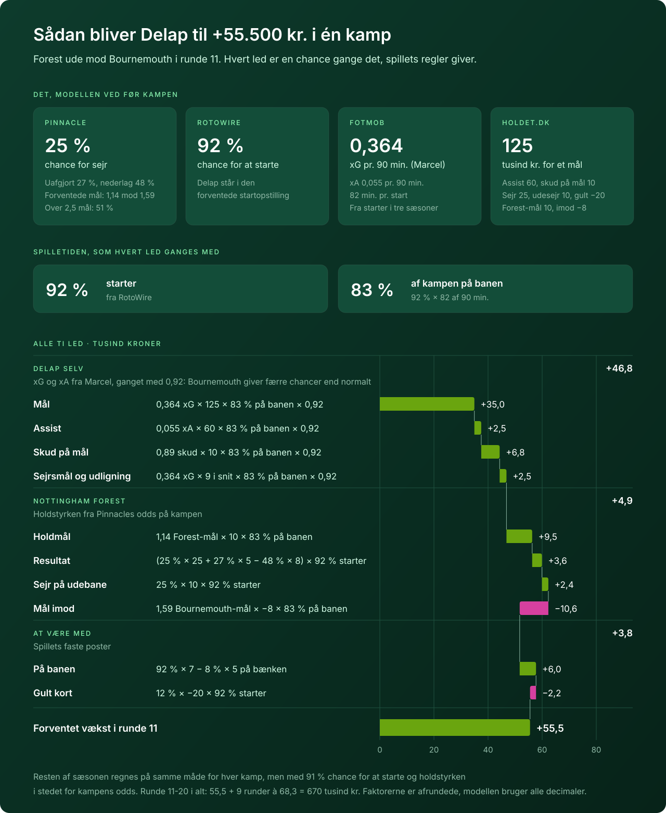</p>

Sådan bliver tallene til kroner for én spiller. Delap ventes at stige 55.500 kr., når Forest spiller ude mod Bournemouth i runde 11. Hvert led er en chance gange det, spillets regler giver, gange hvor meget han ventes at spille.

84 % af det kommer fra Delaps egne mål og chancer og kun 9 % fra Forest. Køber du en angriber, køber du hans chancer. Køber du en forsvarer, køber du hans hold: for Gabriel kommer 66 % af hans forventede vækst i runde 11 fra Arsenal.

## Det samme for alle 591 spillere

<p align="center">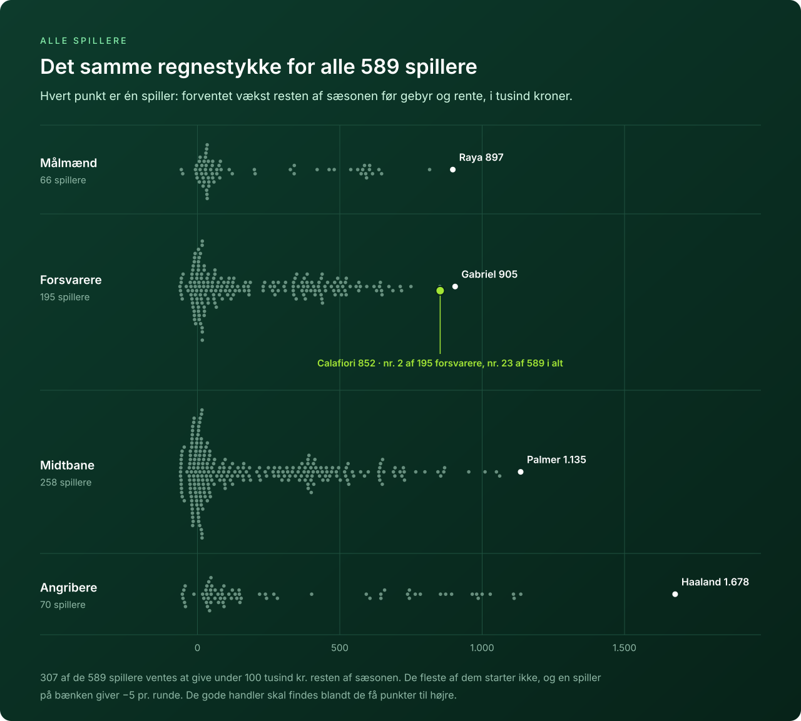</p>

Regnestykket gentages for hver kamp resten af sæsonen og for hver af de 591 spillere i spillet. For Delap giver det 670.000 kr. og en plads som nr. 10 blandt angriberne.

Godt halvdelen af spillerne ventes at give under 100.000 kr., fordi de sjældent starter. De gode handler skal findes blandt de få spillere længst til højre.

## Før en handel anbefales

<p align="center">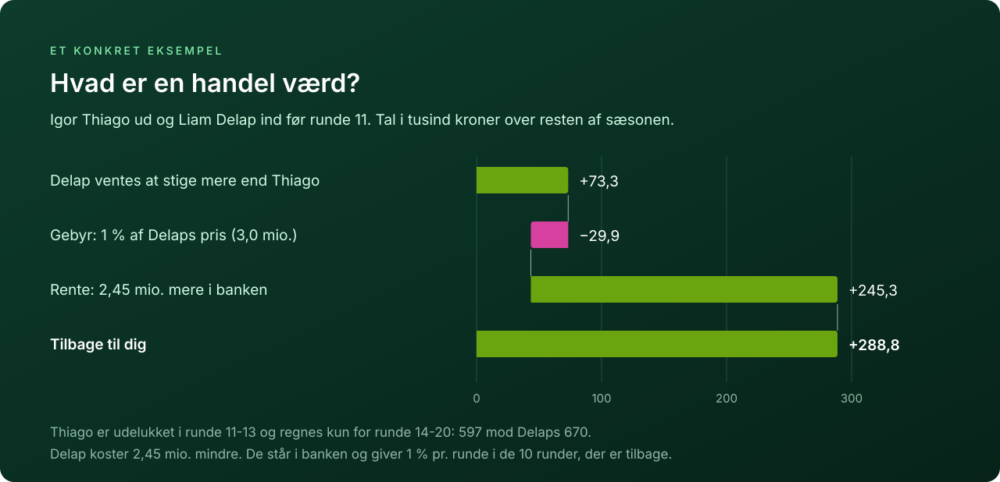</p>

En handel regnes over resten af sæsonen og ikke kun næste runde. Gebyret trækkes fra, og renten regnes med: penge i spillere giver ikke de 1 % pr. runde, som de giver i banken. Her koster Delap 2,45 mio. kr. mindre end Thiago, så renten trækker op og ikke ned.

Thiago er udelukket i runde 11-13. Derfor regnes han kun for runde 14-20, med den startchance, han havde før det røde kort.

<details>
<summary><b>Sådan ser det ud i terminalen</b></summary>
<br>

Mit hold før runde 11 ([`eksempler/hold.json`](eksempler/hold.json)), med modeksemplet fra de seks kontroller nedenfor:

```text
$ python handel.py "Ezri Konsa > Riccardo Calafiori"
hold R11: Raya, Magalhaes, Konsa, Cuyper, Gomez, Gross, Enciso, Delap, Kostoulas, Haaland, Schade

Konsa > Calafiori
  basis +47   forskel -25 % +4   K/2 +65   2K +22   ind pS -0,1 -33   ud pS +0,1 -25
  -> anbefales IKKE (positiv i 4 af 6; vaerst -33 tkr)

UD  Ezri Konsa (ARS, defense/CB): g90 0.05  a90 0.02  pS naeste 0.70  pStart 0.77  ev_tot 496
      bygger paa 2802 vaegtede startminutter (prioren vejer 26 %): 2024 AVL 2892 min (xg90 0.04); 2025 AVL 3036 min (xg90 0.04); 2026 ARS 720 min (xg90 0.08)
      spilletid: RotoWire-status 0.70, startandel 0.89 over 9 klubkampe
      ! klubskifte: minutter fra anden klub vaegtet x0.5
      ! koncentration: 44 % af aarets xG fra eet skud
IND Riccardo Calafiori (ARS, defense/FB): g90 0.12  a90 0.07  pS naeste 0.92  pStart 0.90  ev_tot 667
      bygger paa 2550 vaegtede startminutter (prioren vejer 28 %): 2024 ARS 793 min (xg90 0.1); 2025 ARS 1656 min (xg90 0.17); 2026 ARS 749 min (xg90 0.15)
      spilletid: RotoWire-status 0.92, startandel 0.87 over 15 klubkampe
      ! koncentration: 42 % af aarets xG fra eet skud
```

Under hver spiller står, hvad tallet bygger på: antal minutter, hvor meget det typiske for rollen vejer, og hvad man bør kigge efter. Konsas minutter fra Aston Villa tæller halvt, og RotoWire er i tvivl om, at han starter. Gevinsten afhænger af spilletiden, og den er det sværeste at forudsige.

</details>

<p align="center">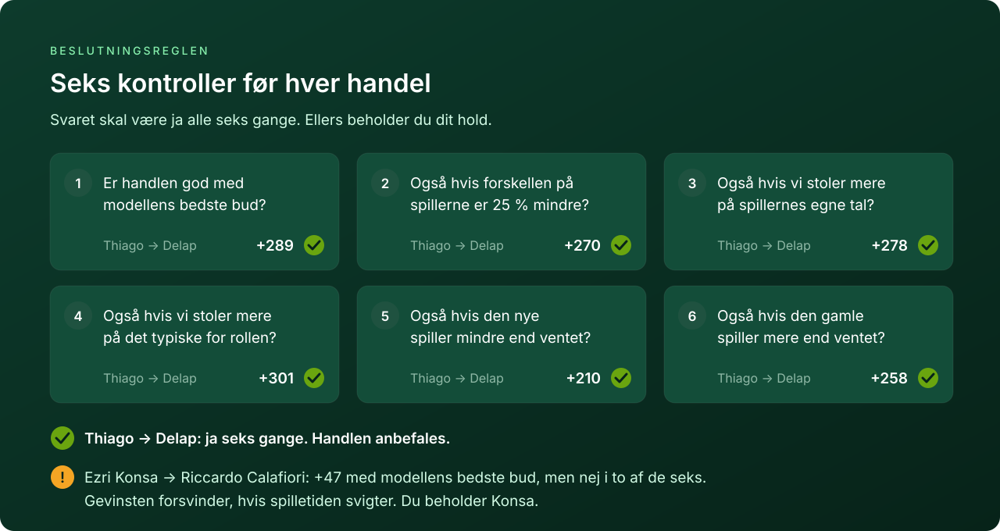</p>

Modellen kan tage fejl, så en handel skal også betale sig, hvis den gør. Målingerne viser tre steder, hvor prognoser som disse rammer ved siden af, og hver kontrol regner handlen igen, som om en af fejlene var sket:

| Kendt fejl | Kontrol |
|---|---|
| Forskellene mellem spillerne er mindre i virkeligheden, end prognosen siger | Forskellen −25 % |
| Vægten på spillerens egne tal kan være for høj eller for lav | K/2 og 2K |
| Spilletid er svær at forudsige | Den nye spiller −0,1 og den gamle +0,1 i spilletid |

Sammen med basis, altså modellens bedste bud, giver det seks kontroller. Ét nej er nok til at beholde holdet. Hviler en ny spillers tal over 50 % på det typiske for rollen, anbefales han aldrig uden et menneskes vurdering.

> [!TIP]
> **Oftest er svaret at beholde holdet.** En handel koster gebyr og rente, så den skal kunne betale sig, også hvis tallene er lidt for optimistiske.

### Rundens handel

<p align="center">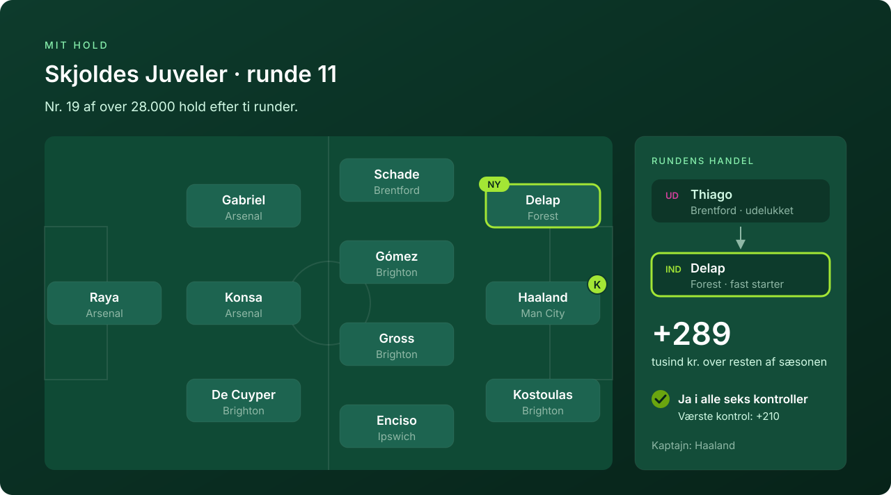</p>

Før runde 11 skiftede jeg Thiago ud med Delap, handlen fra eksemplerne ovenfor. Thiago fik direkte rødt kort i runde 10 og giver 0 point i runde 11-13. Modellen prøvede afløsere i alle tre positioner, fordi en formation med to angribere også var mulig, og Delap var den bedste: 289.000 kr. over resten af sæsonen og 210.000 kr. i den værste af de seks kontroller. De to nærmeste var også angribere. Tal i tusind kroner over resten af sæsonen:

| | Pris | Mere end Thiago | Rente | Gebyr | Gevinst | Værste kontrol |
|---|---:|---:|---:|---:|---:|---:|
| **Liam Delap** (Forest) | 2,99 mio. | +73,3 | +245,3 | −29,8 | **+288,8** | +210 |
| Gonzalo García (Fulham) | 3,77 mio. | +86,7 | +166,2 | −37,7 | +215,2 | +138 |
| Dominic Calvert-Lewin (Leeds) | 5,29 mio. | +238,2 | +12,8 | −52,9 | +198,1 | +105 |

Delap er bedst i alle seks kontroller. Calvert-Lewin er den bedste spiller af de tre og ventes at give 165.000 kr. mere end Delap, men han koster 2,3 mio. mere, og i banken giver de 232.500 kr. i rente. García ventes at give 13.000 kr. mere end Delap, men koster 0,78 mio. mere, og hans tal bygger på færrest kampe: det typiske for en angriber vejer 48 %. Den bedste spiller er ikke altid den bedste handel.

En midlertidig afløser med genkøb af Thiago efter udelukkelsen gav mindre, 185.000 kr. Forskellen i pris står i banken, så et genkøb er stadig muligt. Kortet bliver opdateret efter hver runde.

## Virker det?

<p align="center">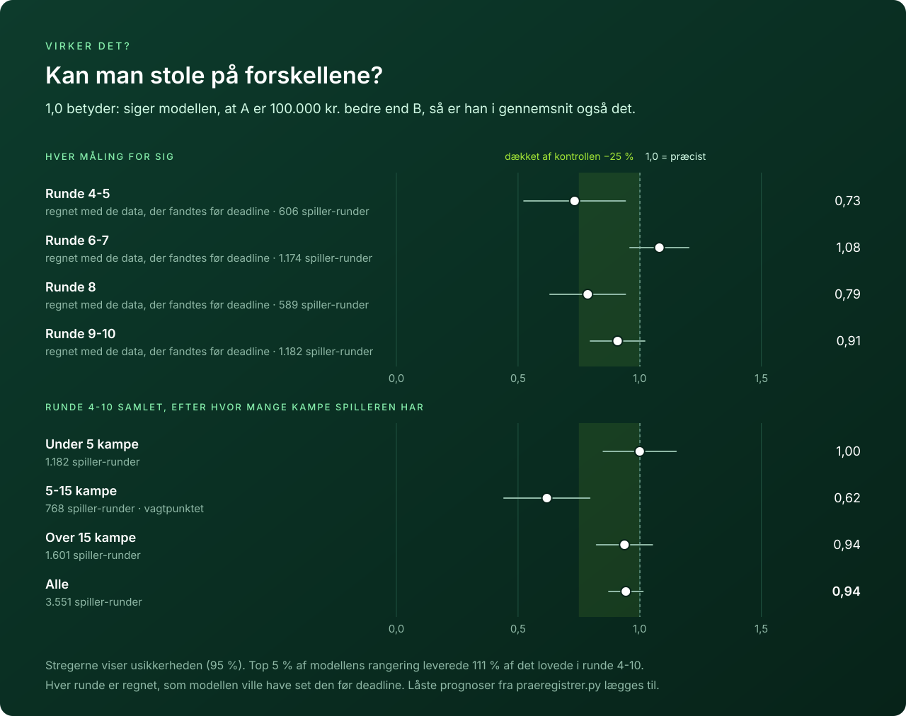</p>

Hver runde fra 4 til 10 er regnet, som modellen ville have set den før deadline: kun kampe, odds og opstillinger, der fandtes på det tidspunkt. Bagefter måles, hvor meget af forskellen mellem spillerne der holdt. 1,0 er præcist, og under 1 betyder, at prognosen overdriver forskellene.

- **Samlet holder det.** Over 3.551 spiller-runder er hældningen 0,94. Det ligger inden for de 25 %, som kontrollen "forskellen −25 %" dækker.
- **Toppen leverer det lovede.** De 5 % højest rangerede spillere leverede 111 % af det lovede, top 10 % 103 % og top 25 % 99 %.
- **Spillere med 5-15 kampe er det svage punkt.** Hældningen er 0,62, så forskellene i den gruppe er overdrevne. Gruppen følges runde for runde, og der ændres først noget, når der er tre runders evidens.
- **Én runde er for lidt.** Hældningen svinger fra 0,73 i runde 4-5 til 1,08 i runde 6-7. Først samlet siger tallene noget.

Hver regel er kun taget ind, fordi den gjorde backtesten bedre. Det gælder også straffe som et separat led og startandelen, der trækkes mod status. Pointene i målingen er holdet.dk's egne prisændringer; for runde 4-5 er de regnet ud fra kampdata med spillets regler. Fra nu af låses prognoserne med `praeregistrer.py` før hver deadline og lægges til, efterhånden som runderne bliver spillet.

## Kom i gang

Du skal bruge Python 3.10 eller nyere. Jeg anbefaler at bruge repoet sammen med [Claude Code](https://claude.com/claude-code). [CLAUDE.md](CLAUDE.md) indeholder arbejdsreglerne: `kvalitet.py` skal stå uden STOP, en handel skal holde i alle seks kontroller, og modellen fryses før deadline. Claude Code læser filen automatisk og følger reglerne. Du kan spørge på almindeligt dansk, for eksempel *"Hent data til runde 11 og find en afløser for Konsa"*, og få svaret regnet på samme måde hver gang.

**Kør det så tæt på deadline som muligt.** Skader, pressemøder og forventede opstillinger ændrer sig hele ugen, og jo tættere du kommer på kampene, jo mindre ændrer data sig. RotoWire skal hentes højst 24 timer før deadline. Selve metoden ændres aldrig det sidste døgn: modellen fryses 24 timer før deadline, og derefter kommer kun nye data ind.

```bash
git clone https://github.com/anjo21ad/holdet-premier-manager.git
cd holdet-premier-manager
cp eksempler/hold.json eksempler/manager_input.json .    # ret hold.json til dit eget hold

python hent.py holdet                       # priser, klubber, kampprogram og resultater
python hent.py fotmob historik              # første gang: to sæsoner i fem ligaer (~3.500 kampe, ca. 45 min)
python hent.py fotmob                       # årets kampe; kør igen efter hver runde
python hent.py odds historik 10             # første gang: odds for de spillede runder
python hent.py odds 11                      # Pinnacle, højst 48 timer før deadline
python hent.py rotowire 11                  # højst 24 timer før deadline

python model.py 11
python facit_alle.py                        # facit fra holdet.dk's priser (hent holdet efter hver runde)
python kvalitet.py --runde 11               # STOP betyder: ingen beslutning på disse data
python handel.py --skan "Ezri Konsa"         # de bedste afløsere, vurderet i alle seks kontroller
```

Testene kører uden data: `python test_model.py`. Hvad du gør før deadline og efter hver runde, står i [docs/arbejdsgang.md](docs/arbejdsgang.md).

<details>
<summary><b>Hvad ligger hvor</b></summary>
<br>

| | |
|---|---|
| `hent.py` | Henter fra holdet.dk, FotMob, Pinnacle og RotoWire (odds for spillede runder fra football-data.co.uk) |
| `model.py` | De tre regler og pointformlen. Skriver `input/board.json` |
| `handel.py` | Seks kontroller pr. handel, `--skan` efter afløsere og `--log` til en beslutningslog |
| `kvalitet.py` | Tjekker data før en beslutning og stopper ved fejl |
| `praeregistrer.py` | Låser alle prognoser før deadline. Nægter at overskrive |
| `facit_alle.py` | Facit for alle spillere fra holdet.dk's priser: point er prisændring |
| `kalibrering_alle.py` | Måler prognoserne mod facit. `--backtest` kører modellen, som den var før hver runde |
| `test_model.py` | Tests på opdigtede spillere og kampe |
| `CLAUDE.md` | Arbejdsreglerne, som Claude Code følger |
| `docs/` | [Metode](docs/metode.md), [pointsystem](docs/pointsystem.md) og [arbejdsgang](docs/arbejdsgang.md) |
| `eksempler/` | Skabeloner til `hold.json` og `manager_input.json` |

</details>

## Kendte forenklinger

- Sat op til Premier Manager i efteråret 2026. Til et nyt spil skal du rette spil-id, sæsoner og holdenes udgangspunkt ([se hvordan](docs/arbejdsgang.md#en-ny-sæson)).
- Straffeandelen bygger på sidste og denne sæson. En spiller, der lige har overtaget straffesparkene, er undervurderet, indtil han har taget nogle.
- Udelukkelser og gule kort ligger ikke i modellen og regnes ved siden af.
- Nye spillere i en klub får deres spilletid fra få kampe.
- Spillere fra ligaer uden for de fem store hviler på det typiske for rollen.
- Oddsene dækker næste runde. De senere runder regnes på holdstyrken.
- Kaptajnens dobbelte vækst regnes med i `handel.py`, men ikke i spillernes tal i `board.json`. Et fald hos kaptajnen trækkes ikke fra, og den bund ligger ikke i modellen.

## Data og vilkår

Repoet indeholder **ingen data**. Scriptene henter fra holdet.dk, FotMob, Pinnacle, football-data.co.uk og RotoWire til din egen computer, og data kommer aldrig med i repoet. Du er selv ansvarlig for at bruge kilderne efter deres vilkår.

Projektet er ikke tilknyttet holdet.dk, FotMob, Pinnacle, football-data.co.uk eller RotoWire.

## Licens

Koden er under [MIT](LICENSE). Skriften i illustrationerne er [Inter](https://rsms.me/inter/) under [SIL Open Font License](docs/img/LICENSE-Inter.txt).
